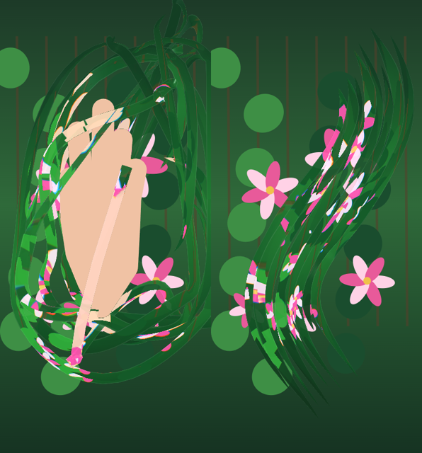

# Glass Ribbons

A live webcam effect: strips of glass loop around your hand and bend the room behind them, like ribbons cut from a prism. Open your hand and they fling wider; close it and they circle your fist; take your hand away and they settle into a tall S that hangs in the air.



*The built-in preview mode (no camera): a painted garden with a stand-in hand. With a real camera the glass shows your own room.*

Inspired by a reel from [@alwayscodingsomething](https://www.instagram.com/alwayscodingsomething/) on Instagram. This is an independent remake written from scratch; no footage or code from the original is included.

## Try it

You need:

- [Node.js](https://nodejs.org/) 20.19 or newer
- a webcam
- Chrome or Edge (Firefox and Safari may work, but aren't tested)

```bash
git clone https://github.com/lumenchancer6/glass-ribbons-public.git
cd glass-ribbons-public
npm install
npm run dev
```

Open the address Vite prints (normally http://127.0.0.1:5238) and allow the camera.

`npm install` also downloads MediaPipe's hand-tracking and person-segmentation models (about 8 MB) from Google and copies its runtime next to the page, so everything runs locally in your browser. Nothing is uploaded anywhere.

## Using it

- **Hold up a hand.** The ribbons are released from around it and loop past and behind your fingers. Your hand stays in front.
- **Open your hand quickly** to fling them wider. **Make a fist** and they pull in and circle it.
- **Take your hand out of frame** and within a couple of seconds the ribbons settle into a tall S and hang there.
- **Bright, colourful backgrounds look best.** The glass only shows what is behind it, so a dim room looks murky.

| Key | Action |
| --- | --- |
| `C` | Vertical 9:16 frame, for filming |
| `H` | Hide the hint text |
| `M` | Mirror on or off |
| `V` | Start or stop recording a WebM |
| `F` | Full screen |

**No camera?** Open `http://127.0.0.1:5238/?preview=1` to see it with a stand-in hand over a painted garden.

**Got a clip?** Drag a video file onto the page to run the effect on it instead of the camera.

## How it works

- [MediaPipe](https://ai.google.dev/edge/mediapipe/solutions/vision/hand_landmarker) tracks the hand, and its selfie segmenter cuts you out so the ribbons can pass behind you.
- Each ribbon is a line of points released from a spot circling the hand. Once released, a point drifts on a slow, swirling current and is guided onto its own tilted loop, so the strips stay separate and keep clear of your palm.
- Each strip is drawn with [three.js](https://threejs.org/) and a small shader that samples the camera image behind it, offset and split into patches, so it reads as cut glass bending the scene rather than a coloured shape.

The main pieces are `src/ribbons.ts` (motion), `src/shaders.ts` (the glass look), `src/vision.ts` (tracking) and `src/app.ts` (camera, keys, recording).

## Build

```bash
npm run build     # type-checks and writes dist/
npm run preview   # serves dist/ locally
```

## Windows desktop shortcut (optional)

`tools/` has a small Python launcher that rebuilds when the source changes, serves the build and opens it in your browser:

```powershell
python tools/make_icon.py
powershell -ExecutionPolicy Bypass -File tools/install_shortcut.ps1
```

## Credits

- Effect idea: [@alwayscodingsomething](https://www.instagram.com/alwayscodingsomething/)
- Hand tracking and segmentation: [MediaPipe Tasks Vision](https://github.com/google-ai-edge/mediapipe) and its models (Apache 2.0)
- Rendering: [three.js](https://threejs.org/) (MIT)
